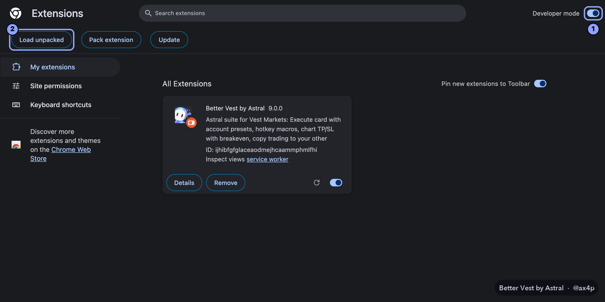

# Installing Better Vest

About two minutes, in Chrome, Brave, Edge or Arc on a computer (not on phones). The site has a video of every step, for a Mac and for Windows: **[bv.astrals.dev/#install](https://bv.astrals.dev/#install)**.

1. Download a zip from the [latest release](https://github.com/ax4p/better-vest/releases/latest), under Assets. Not "Source code": that one won't install. `better-vest-9.3.3.zip` is the one most people want ([which zip?](README.md#download)).
2. Unzip it into a folder you keep, like Documents. On a Mac, double-click the zip. On Windows, right-click it and choose **Extract All**. Chrome runs Better Vest from that folder, so don't delete it.
3. Open `chrome://extensions` (Brave: `brave://extensions`, Edge: `edge://extensions`).
4. Turn on **Developer mode**, top right, then click **Load unpacked** and pick the folder you unzipped (the folder, not the zip).
5. Pin it: the puzzle piece in the toolbar, then the pin next to Better Vest.
6. Open [next.vestmarkets.com](https://next.vestmarkets.com). The dock shows up in Vest's top bar.

Chrome may warn about extensions in developer mode when it starts. That's normal for anything installed this way: click **Keep**, and leave Developer mode on.

Start with your smallest size, and watch your first few orders the way you would with any new setup.

## Updating

When a new version is out, an **Update** button shows up in the dock. Click it, read what's new, then **Update**. The first time, Chrome asks for your Better Vest folder; after that it's one click. Before it writes anything it checks my signature and every file, and your settings and Calendar stay as they are. The same page can switch you to another edition (Standard, Lite or No stats). Settings > More > About > **Check for updates** opens it any time.

## If something's off

- **Nothing shows up on Vest:** check Better Vest is switched on in `chrome://extensions`, reload the Vest tab, and keep only one copy installed.
- **It was switched off after an update:** Developer mode is off. Turn it on, then switch Better Vest back on.
- **Tab groups called "Copy" or "Charts" opened:** that's the copy trader's Turbo mode and the extra charts' data tabs. They close when you stop copying or go back to one chart.

Still stuck: Discord **@ax4p**.

## Removing it

Click **Remove** on Better Vest in `chrome://extensions`, then delete the folder. Your Vest account isn't touched.
