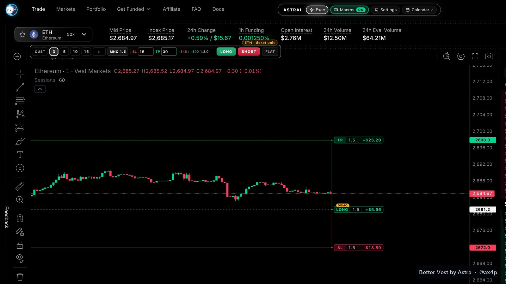

  

<h1 align="center">Better Vest</h1>

  <b>The trading tools I wanted on Vest, added to the Vest page you already use.</b> 
  A free Chrome extension for <a href="https://next.vestmarkets.com">Vest Markets</a>. By Astral, Discord <b>@ax4p</b>.

  <a href="https://bv.astrals.dev"><b>bv.astrals.dev</b></a>
  &nbsp;·&nbsp; <a href="https://github.com/ax4p/better-vest/releases/latest">Download</a>
  &nbsp;·&nbsp; <a href="https://bv.astrals.dev/#install">Install</a>
  &nbsp;·&nbsp; <a href="SECURITY.md">Security</a>

 

Every tool, and the install on a Mac and on Windows, is shown on **[bv.astrals.dev](https://bv.astrals.dev)**. This repo holds the code and the releases.

## Download

Each [release](https://github.com/ax4p/better-vest/releases/latest) has three zips. Pick one:

| Zip | What's in it |
|---|---|
| `better-vest-9.0.6.zip` | **Standard.** Everything. Take this one if you're not sure. |
| `better-vest-lite-9.0.6.zip` | **Lite.** Everything but the voice, under 1 MB. |
| `better-vest-nostats-9.0.6.zip` | **No stats.** Standard without the usage stats. See [Security](SECURITY.md#the-usage-count). |

Then load it in Chrome: the [video and steps](https://bv.astrals.dev/#install) on the site, or the [install guide](CONTRIBUTING.md) here. After that it updates itself.

## What it does

- **[Copy trader](https://bv.astrals.dev/features/copy-trader):** trade one account and up to ten others follow it, in as many groups as you like.
- **[Trading on the chart](https://bv.astrals.dev/features/chart-trading):** drag your stop and target, stop and limit orders in one click, a trailing stop and auto breakeven.
- **The Execute card:** long or short in one click with the stop and target attached, in points, dollars or at a price, your size from the dollars you risk, and FLAT, 50% (hover it for 10%, 25%, 75% or your own share) and REV.
- **[Up to four charts](https://bv.astrals.dev/features/multi-chart),** each with its own market and timeframe.
- **[Limits and locks](https://bv.astrals.dev/features/limits):** a daily loss and profit limit, a tilt guard, and a lock button for the days you should stop.
- **A voice** that says what just filled, and a countdown to the New York open and the news.
- **[P&L cards](https://bv.astrals.dev/features/pnl-cards)** of your day as an image, a video or a GIF, and a payout card.
- **[The Calendar](https://bv.astrals.dev/features/calendar):** every trade from every account as a daily P&L calendar.

## Is it safe?

- **Scanned.** `better-vest-9.0.6.zip` comes back clean from all 66 antivirus engines on VirusTotal ([report](https://www.virustotal.com/gui/file/c644f33fb0e1f3da46d1e82da384c275317258dd55b2f9fe8c7d98ddb171fabf)).
- **Readable.** The [`extension`](extension) folder is the Standard zip, file for file, not minified.
- **Signed updates.** Your copy checks my signature and every file before it writes anything.
- **Small reach.** It runs only on next.vestmarkets.com and asks Chrome for `storage`, `alarms` and `tabGroups`. It never sees your password or keys, never withdraws, and trades only through Vest's own buttons and order code.

Everything it can do and every address it talks to: [Security](SECURITY.md).

## Is it allowed on Vest?

Vest's [terms](https://next.vestmarkets.com/terms) don't mention browser extensions or copy trading. The automation they rule out is manipulation, and Better Vest only places the orders you ask for, through Vest's own page. It doesn't use an API. Terms change, so read them yourself, especially before you copy trades on funded accounts.

## Support

Better Vest is free. If you buy a Vest account, the code **WICK** costs you nothing extra and keeps this going. The extension offers it when you press a button that buys, and only uses it if you say yes. If you'd rather tip, my EVM address is `0x9F308B10780f9b8FD65C6B94071529b75a3A9dA4`.

Bugs and ideas: Discord **@ax4p**.

## Credits and rights

Designed and built by **Astral** (Discord **@ax4p**). Not affiliated with Vest Markets.

© 2026 Astral. All rights reserved. You're welcome to install it and use it for your own trading. Redistributing it, selling it, rebranding it or publishing changed versions needs my permission. The full terms are in [LICENSE](LICENSE).
